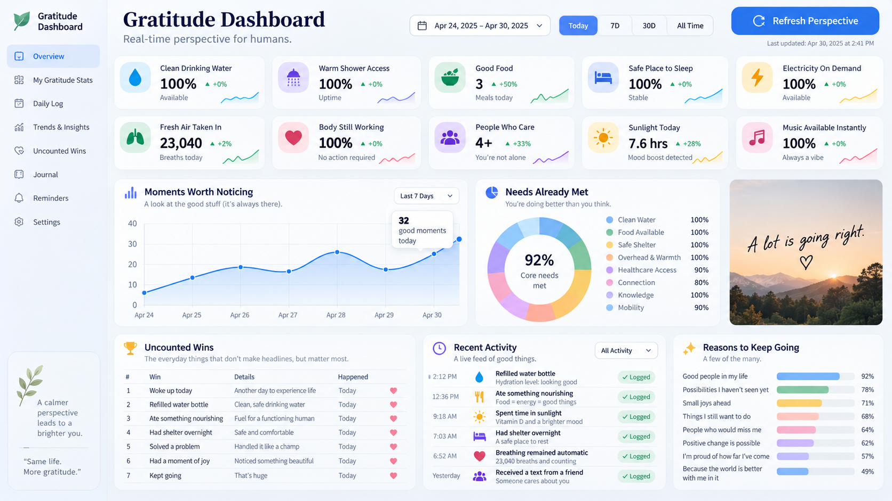

# Gratitude Dashboard

A responsive dashboard built with plain HTML, CSS, and JavaScript. Open `index.html` in a browser; no install, build step, API key, or internet connection is needed.

Every page load and **Refresh Perspective** creates a new set of positive sample data. Each headline metric changes from the previous snapshot, all trends point upward, and the chart, core needs, reasons, activity, and encouragement are randomized.

- Switch the moments chart between today, seven days, thirty days, and all available sample history.
- Filter recent activity by essentials, connection, or small joys.
- Save everyday wins with the heart buttons and keep a gratitude journal. These stay in your browser’s local storage; generated metrics reset on refresh.
- Keyboard navigation, chart tooltips, reduced motion, and phone, tablet, and desktop layouts are supported.

For a local HTTP preview, run `python3 -m http.server 4173` and open `http://localhost:4173`.

Run the data generation checks with Node.js: `node --test tests/data.test.cjs`.

The original visual reference:

